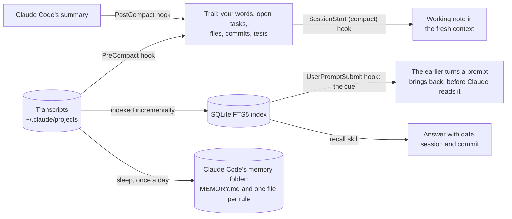

# LR Memory for Claude Code

[](https://github.com/cihanatak/lr-memory/actions/workflows/tests.yml)

[Türkçe](README.tr.md)

Long Claude Code sessions lose their thread when the conversation is compacted. Every new session knows nothing of the old ones, and a correction you made last week has to be made again. LR Memory addresses all three:

1. **A working note across compaction.** Right before Claude Code compacts a conversation, a hook reads the transcript and keeps what summaries tend to lose: your last messages word for word, the open tasks, the files changed, the commits and the latest test results. Right after, a short note made from them (at most 9,000 characters) goes back into the fresh context, with a pointer to the full record.
2. **The cue: earlier turns come back on their own.** Before Claude reads your prompt, a hook searches this project's earlier sessions with the prompt's words. The turns it brings back, each with what you said and what was answered, go in front of Claude word for word: three at most, each once a session. A reason you gave last week, or a number Claude measured yesterday, is there without anyone having to think of looking for it.
3. **Recall over every past session.** A local search index over all the transcripts Claude Code keeps in `~/.claude/projects`: your messages, Claude's answers, commits, commands, compaction summaries, subagent reports and memory files. The `recall` skill makes Claude search it before redoing or guessing anything that happened earlier, and answer with the date, the session and the commit.
4. **Sleep: your own words become memory.** Once a day if you turn it on, or whenever you run `/lr-memory:sleep`, a pass reads what you said in each project since the last pass. The standing rules and corrections you gave go into Claude Code's own memory folder, which every later session loads. A lesson inferred from what happened waits until a later pass backs it with new evidence.

The note, the cue and the search need no server, no network and no model calls. Sleep is the one part that calls the model: once per project with new messages, and only when you run it or turn it on. It is all Python's standard library, four hooks and two skills.

## Install

In Claude Code:

```
/plugin marketplace add cihanatak/lr-memory
/plugin install lr-memory@living-runtime
```

Then restart Claude Code, since hooks are loaded when it starts.

**Requirements:**
- Claude Code. Tested with 2.1.235 and 2.1.308.
- Python 3.9 or newer on `PATH` as `python3`, `python` or `py`.
- `sh`, which macOS and Linux have. On Windows, Claude Code runs hooks with Git Bash, which provides it.
- For sleep, the `claude` command on `PATH`, signed in from a terminal: run `claude`, then `/login`. Sleep starts its own `claude` and cannot borrow the login of the session it runs from, because Claude Code keeps that login out of the shell it gives to tools and hooks. If you use Claude Code only inside the Claude desktop app, sign in this way once.

## Use

- **The note** needs nothing from you. It appears after every compaction, automatic or `/compact`.
- **The cue** needs nothing from you either. A prompt that shares at least three words with an earlier turn of the same project brings that turn back; a short or unrelated prompt brings nothing. When it finds something, it adds a few hundred tokens. Set `LR_MEMORY_CUE` to `off` to turn it off.
- **Recall** works by asking about the past, in your own words:
  - "How did we fix the login redirect last time?"
  - "Which commit changed the cache key?"
  - "What did we decide about the retry limit?"

  Claude searches the record, opens the turn that matches and answers with its source. When nothing matches, it says so instead of guessing.
- **From a shell**, the note prints the exact command for this machine. It has this shape:

  ```bash
  sh <plugin folder>/scripts/run.sh search staging proxy port
  sh <plugin folder>/scripts/run.sh show 3f2a9c1e:5852
  ```

  Narrow a search with `--kind user,commit`, `--since 2026-10-20`, `--session 3f2a9c1e` or `-k 5`.
- **Sleep** runs when you ask for it:
  - `/lr-memory:sleep` runs a pass now. It reports what was written, what waits and what was rejected, with the cost in tokens.
  - `/lr-memory:sleep --dry-run` shows the same and writes nothing.
  - To have it run once a day on its own, set `LR_MEMORY_SLEEP` to `daily`. The first session start after 20 hours then runs a pass in the background.
  - Every report is kept in `~/.claude/lr-memory/sleep/reports/`.

## How it works



**Design choices:**
- **Verbatim, not rewritten.** A summary keeps the gist, but a correction like "don't touch the old migration" turns into a generic sentence, and file and commit trails are the first to go. The note copies them from the transcript mechanically.
- **An index into the record, not a copy.** The transcripts stay the source. A search returns a few short hits, each with its source, and the model opens the one it needs.
- **Brought back, not looked up.** On the cross-session bench, the recall skill was loaded in 13 sessions and used in none: a model that does not know what it is missing does not search for it. The cue runs the search on every prompt instead, the way a cue brings back a memory. It searches only this project's sessions. It ranks turns by BM25, so a long reply that shares many of a prompt's common words does not outrank a short message that shares its rare ones. A turn that shares fewer than three of the prompt's words stays out.
- **Plain keyword search with light stemming.** Search needs no embeddings, no vector store and no server. Letters are folded (ı→i, ş→s, accents dropped) and each query word is cut to its first five letters. For Turkish, this works about as well as a full stemmer (Can et al., JASIST 2008), so `düzeltmiştik` finds `düzeltme`. In English, `comparator` finds `compare`. A hit with the whole word ranks above one with only the cut form. A name made of parts (`listed_commits`, `predict.py`) is matched whole.
- **Never in the way.**
  - A failing hook exits 0 and writes to `errors.log`; it never stops a compaction or a session start.
  - Each search first indexes only what was appended since the last one, newest sessions first. A first search on a long history stops indexing after 40 seconds and says how much is left.
  - A search leaves out what the current session said since its last compaction: that is in context already, and the question just asked would otherwise come back as the top hit.
  - At session start, the index is brought up to date in the background.
- **Keys stay out.** Key-shaped strings (Anthropic, OpenAI, GitHub, AWS, Google, Slack, Hugging Face, private keys) are masked before they enter the index. A search can never print one.
- **Sleep writes only what the record backs.**
  - Every proposal must quote you word for word or cite a commit from these sessions. A quote that is not in the message it names is dropped, and so is anything that looks like a key or a password.
  - A standing rule, preference or prohibition you stated in so many words is written the same day.
  - A lesson inferred from what happened waits as a candidate, which no session sees, until a later pass backs it with evidence it did not have. One not backed again within 14 days fades, and one that later evidence contradicts is withdrawn. Replay can strengthen a wrong generalisation as readily as a right one: in LR, one misread measurement once became a rule sixty times off.
  - An update appends under a dated heading and never rewrites. A rule is retired only on your own words, into `memory/_retired/`. Every file is backed up before it changes.
  - When you had to repeat something an existing rule already says, the report names that rule: it did not hold.
  - Pasted text is not your words, so it is left out.
- **Sleep stays out of the way.**
  - The `claude -p` it starts runs in an empty folder, with no tools, no MCP servers, no hooks and no session record.
  - It skips a project while a session is writing its `MEMORY.md`, or while Claude Code's own memory consolidation runs there.
  - It follows Claude Code's `autoMemoryEnabled` and `autoMemoryDirectory` settings.

## Measured on the author's machine

- **Said once on day 1, needed on day 2.** In [the cross-session bench](bench/cross_session/DESIGN.md), day 1 is six messages of work, and day 2 a fresh session with three tasks that depend on them. Claude Code's own memory was on in every arm; Sonnet 5.5, five chains, the same day 1 for each arm.
  - Claude Code alone kept the standing rules. In all five chains it lost why a tax rate had been corrected and the baseline it had measured itself, and asked for both.
  - With LR Memory 0.3.0, the reason reached the code and the baseline reached the report in all five. Over the seven memory and rule checks, it passed where Claude Code alone failed 10 times, and the other way round once (sign test, p = 0.012). With the sleep pass turned off, the cue alone did the same in 3 of 3 chains. The cue was designed on the first chain's record; the other four were held out.
  - Day-2 tokens stayed within the spread between runs: chain by chain, from 28% fewer to 4% more, with a median of 0%.
  - Not solved: no arm kept its answers short after a complaint about their length. LR Memory 0.2.0, which had no cue, carried the two facts over in 2 of 5 chains each.
  - [A second job](bench/cross_session/kargo/DESIGN.md), built so that nothing in it was fitted to the cue: a Turkish shop's shipping module, with messages written by a subagent that was not told how the cue matches words; three chains. With LR Memory 0.3.0, the measured number and the reason came back in all three. Claude Code alone wrote the number in none, and the reason only where day 1 had put it in the repository (7 wins, 1 loss, p = 0.07; with the first job's held-out chains, 15 and 2, p = 0.002).
  - Not carried by the cue: an API's rate limit, mentioned in passing in a message about something else. It shares no words with the later task that needs it. The sleep pass carried it in 1 of 3 chains. In the second job, day 2 cost 18% to 94% more with LR Memory: Claude Code alone, missing yesterday's number, asked for it instead of writing the day's report, in all three chains.
- **Index:** 575 transcripts (6.6 GB) were indexed from scratch in 41 seconds, into 77,471 parts and a 129 MB index. A search then takes about half a second, Python's start-up included.
- **Search output:** a search prints 0.4–1.2 KB, a few hundred tokens. Grepping the raw `.jsonl` files for the same words printed 0.3–4.5 MB.
- **Token load:** one day of long sessions read 586 million tokens over 1,108 model calls, with a median of 543,000 tokens per call. Every turn re-reads the whole context, so long contexts cost on every turn.
  - Lowering Claude Code's compaction window (`"autoCompactWindow": 400000` in `settings.json`) makes each turn cheaper. In [the long-session bench](bench/long_session/README.md), a ten-message job on Sonnet 5.5 used 24–27% fewer tokens with a 100k window than with a 1M one. All nine runs passed all 16 checks.
  - The note made no measurable difference there. Claude Code's own summary was enough for that job, so the bench does not show that the note makes compactions safer.
  - The search carried the work over to the next day. Fresh sessions were asked three questions each about the earlier session: nine with LR Memory got 27 of 27 right, nine without it got 10. A session cost about 49,000 tokens either way.
- **Sleep:**
  - A pass over a project with six messages and one commit took 9 seconds and 3,631 tokens on Sonnet 5.5. It made three changes, each backed by a quote: two new rules, and an addition to the rule the user had to repeat, which the report named.
  - On the author's own machine, a first pass would read 38 messages out of the day's 979 MB of transcripts, which takes 2.5 seconds. Its prompt would come to about 26,000 tokens, most of them the one-line descriptions of the 410 memory files already there.

## Configuration

Set these as environment variables, for example under `"env"` in `~/.claude/settings.json`:

| Variable | Default | Meaning |
| --- | --- | --- |
| `LR_MEMORY_LANG` | auto | `en` or `tr`. Auto writes Turkish when your messages read as Turkish. |
| `LR_MEMORY_DATA` | `~/.claude/lr-memory` | Where the index and the trails are kept. |
| `LR_MEMORY_TRANSCRIPTS` | `~/.claude/projects` | Where the transcripts are read from. |
| `LR_MEMORY_CUE` | on | `off` turns the cue off. |
| `LR_MEMORY_SLEEP` | off | `daily` runs a sleep pass at the first session start after 20 hours. |
| `LR_MEMORY_SLEEP_MODEL` | your default | The model for sleep, such as `sonnet` or `opus`. |
| `LR_MEMORY_CLAUDE` | `claude` on `PATH` | The `claude` command sleep runs. |

`CLAUDE_CONFIG_DIR` is respected when set.

## Privacy and removal

The note, the cue and the index stay on your machine. The index holds text from your own transcripts, with keys masked. Sleep sends the messages it reads, keys masked, to the model through your own Claude Code login, as any session does.

To remove LR Memory, run `/plugin uninstall lr-memory@living-runtime`, then delete `~/.claude/lr-memory`. That folder holds the index, the trails and sleep's reports, candidates and backups. The memory files sleep wrote stay in Claude Code's memory folder, where you can edit or delete them like any other.

## Develop

```bash
python -m pytest tests
```

The tests use temporary folders only. They never read your real `~/.claude`, start Claude or touch the network.

## COL, the other plugin here

This marketplace has a second plugin, independent of LR Memory. **COL** does four things:
- It checks Claude's last message against what actually ran: a commit it names must exist, a file it cites must be on disk, and a test count must appear in real test output.
- It keeps a ledger of measurable predictions before long jobs and steps that cannot be taken back, and compares them with the results.
- It stops a commit or a push that would carry a key.
- When a check fails again the same way after an edit, it asks for two rival explanations and one command that tells them apart. [The bench](bench/README.md) has its measured effect, which is small.

It is local and makes no model calls.

```
/plugin install col@living-runtime
```

See [plugins/col/README.md](plugins/col/README.md).

LR Memory is cut out of LR (Living Runtime), the author's agent runtime, where it has run since October 2026.

## License

MIT
