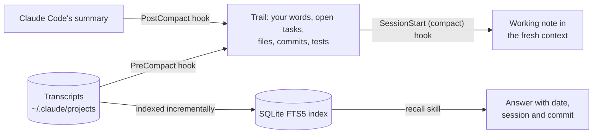

# LR Memory for Claude Code

[Türkçe](README.tr.md)

Long Claude Code sessions lose their thread when the conversation is compacted, and every new session knows nothing of the old ones. LR Memory addresses both, locally and without spending model tokens:

1. **A working note across compaction.** Right before Claude Code compacts a conversation, a hook reads the transcript and keeps what summaries tend to lose: your last messages word for word, the open tasks, the files changed, the commits and the latest test results. Right after, a short note made from them (at most 9,000 characters) goes back into the fresh context, with a pointer to the full record.
2. **Recall over every past session.** A local search index over all the transcripts Claude Code keeps in `~/.claude/projects`: your messages, Claude's answers, commits, commands, compaction summaries, subagent reports and memory files. The `recall` skill makes Claude search it before redoing or guessing anything that happened earlier, and answer with the date, the session and the commit.

No server, no network, no model calls: two Python scripts using only the standard library, three hooks and one skill.

## Install

In Claude Code:

```
/plugin marketplace add cihanatak/lr-memory
/plugin install lr-memory@living-runtime
```

Then restart Claude Code, since hooks are loaded when it starts.

**Requirements:**
- Claude Code. Tested with 2.1.235 and 2.1.308.
- Python 3.9 or newer on `PATH` as `python3`, `python` or `py`.
- `sh`, which macOS and Linux have. On Windows, Claude Code runs hooks with Git Bash, which provides it.

## Use

- **The note** needs nothing from you. It appears after every compaction, automatic or `/compact`.
- **Recall** works by asking about the past, in your own words:
  - "How did we fix the login redirect last time?"
  - "Which commit changed the cache key?"
  - "What did we decide about the retry limit?"

  Claude searches the record, opens the turn that matches and answers with its source. When nothing matches, it says so instead of guessing.
- **From a shell**, the note prints the exact command for this machine. It has this shape:

  ```bash
  sh <plugin folder>/scripts/run.sh search staging proxy port
  sh <plugin folder>/scripts/run.sh show 3f2a9c1e:5852
  ```

  Narrow a search with `--kind user,commit`, `--since 2026-10-20`, `--session 3f2a9c1e` or `-k 5`.

## How it works



**Design choices:**
- **Verbatim, not rewritten.** A summary keeps the gist, but a correction like "don't touch the old migration" turns into a generic sentence, and file and commit trails are the first to go. The note copies them from the transcript mechanically.
- **An index into the record, not a copy.** The transcripts stay the source. A search returns a few short hits, each with its source, and the model opens the one it needs.
- **Plain keyword search with light stemming.** Search needs no embeddings, no vector store and no server. Letters are folded (ı→i, ş→s, accents dropped) and each query word is cut to its first five letters. For Turkish, this works about as well as a full stemmer (Can et al., JASIST 2008), so `düzeltmiştik` finds `düzeltme`. In English, `comparator` finds `compare`. A hit with the whole word ranks above one with only the cut form. A name made of parts (`listed_commits`, `predict.py`) is matched whole.
- **Never in the way.**
  - A failing hook exits 0 and writes to `errors.log`; it never stops a compaction or a session start.
  - Each search first indexes only what was appended since the last one, newest sessions first. A first search on a long history stops indexing after 40 seconds and says how much is left.
  - A search leaves out what the current session said since its last compaction: that is in context already, and the question just asked would otherwise come back as the top hit.
  - At session start, the index is brought up to date in the background.
- **Keys stay out.** Key-shaped strings (Anthropic, OpenAI, GitHub, AWS, Google, Slack, Hugging Face, private keys) are masked before they enter the index. A search can never print one.

## Measured on the author's machine

- **Index:** 575 transcripts (6.6 GB) were indexed from scratch in 41 seconds, into 77,471 parts and a 129 MB index. A search then takes about half a second, Python's start-up included.
- **Search output:** a search prints 0.4–1.2 KB, a few hundred tokens. Grepping the raw `.jsonl` files for the same words printed 0.3–4.5 MB.
- **Token load:** one day of long sessions read 586 million tokens over 1,108 model calls, with a median of 543,000 tokens per call. Every turn re-reads the whole context, so long contexts cost on every turn.
  - Lowering Claude Code's compaction window (`"autoCompactWindow": 400000` in `settings.json`) makes each turn cheaper.
  - Compactions then come more often, and the working note is what makes that safe.

## Configuration

Set these as environment variables, for example under `"env"` in `~/.claude/settings.json`:

| Variable | Default | Meaning |
| --- | --- | --- |
| `LR_MEMORY_LANG` | auto | `en` or `tr`. Auto writes Turkish when your messages read as Turkish. |
| `LR_MEMORY_DATA` | `~/.claude/lr-memory` | Where the index and the trails are kept. |
| `LR_MEMORY_TRANSCRIPTS` | `~/.claude/projects` | Where the transcripts are read from. |

`CLAUDE_CONFIG_DIR` is respected when set.

## Privacy and removal

Everything stays on your machine. The index holds text from your own transcripts, with keys masked.

To remove LR Memory, run `/plugin uninstall lr-memory@living-runtime`, then delete `~/.claude/lr-memory`.

## Develop

```bash
python -m pytest tests
```

The tests use temporary folders only. They never read your real `~/.claude`, start Claude or touch the network.

## Roadmap

- **Sleep (next):** a nightly pass that turns the day's corrections into memory rules. A lesson drawn from an incident first waits as a candidate, and becomes a rule only when a later night supports it again.
- **COL:** a separate plugin for checking claims against tool output, a prediction ledger for long jobs, and a secret scan before `git commit` and `git push`.

LR Memory is cut out of LR (Living Runtime), the author's agent runtime, where it has run since October 2026.

## License

MIT
