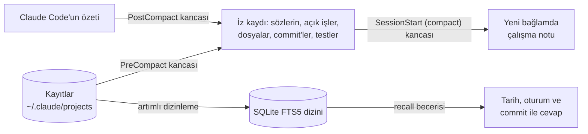

# Claude Code için LR Memory

[English](README.md)

Uzun Claude Code oturumları, sohbet özetlenince işin ipini kaybeder. Her yeni oturum da eskilerden habersiz başlar. LR Memory ikisini de yerelde ve model tokenı harcamadan çözer:

1. **Özetlemeyi aşan çalışma notu.** Claude Code sohbeti özetlemeden hemen önce bir kanca kaydı okur. Özetlerin en çok kaybettiklerini saklar: son mesajlarının birebir hâli, açık işler, değişen dosyalar, commit'ler ve son test sonuçları. Özetlemeden hemen sonra bunlardan çıkan kısa bir not (en çok 9.000 karakter) tam kayda giden yolla birlikte yeni bağlama geri konur.
2. **Bütün geçmiş oturumlarda arama.** Claude Code'un `~/.claude/projects` altında tuttuğu bütün kayıtlar için yerel bir arama dizini: senin mesajların, Claude'un cevapları, commit'ler, komutlar, özetler, alt ajan raporları ve hafıza dosyaları. `recall` becerisi, daha önce yapılmış bir şeyi yeniden yapmadan ya da tahmin etmeden önce Claude'a bu dizinde aratır. Cevap tarih, oturum ve commit ile gelir.

Sunucu, ağ ve model çağrısı yok. Yalnız standart kütüphaneyi kullanan iki Python betiği, üç kanca ve bir beceriden oluşur.

## Kurulum

Claude Code içinde:

```
/plugin marketplace add cihanatak/lr-memory
/plugin install lr-memory@living-runtime
```

Ardından Claude Code'u yeniden başlat. Kancalar açılışta yüklenir.

**Gerekenler:**
- Claude Code. 2.1.235 ve 2.1.308 ile denendi.
- `PATH` üzerinde `python3`, `python` ya da `py` adıyla Python 3.9 veya üstü.
- `sh`. macOS ve Linux'ta zaten var. Windows'ta Claude Code kancaları Git Bash ile çalıştırır ve `sh` oradan gelir.

## Kullanım

- **Not** senden bir şey istemez. Her özetlemeden sonra kendiliğinden gelir; otomatik özetlemede de `/compact` ile de.
- **Hatırlama** için geçmişi kendi sözlerinle sorman yeter:
  - "Geçen sefer giriş yönlendirmesini nasıl düzeltmiştik?"
  - "Önbellek anahtarını hangi commit değiştirdi?"
  - "Yeniden deneme sınırında ne karar vermiştik?"

  Claude kayıtta arar, uyan konuşmayı açar ve kaynağıyla cevap verir. Bir şey bulamazsa tahmin etmez, bulamadığını söyler.
- **Kabuktan kullanmak** istersen, bu makinedeki tam komut notun içinde yazar. Biçimi şöyledir:

  ```bash
  sh <eklenti klasörü>/scripts/run.sh search staging proxy port
  sh <eklenti klasörü>/scripts/run.sh show 3f2a9c1e:5852
  ```

  Aramayı daraltmak için `--kind user,commit`, `--since 2026-10-20`, `--session 3f2a9c1e` ya da `-k 5` kullanılır.

## Nasıl çalışır



**Tasarım kararları:**
- **Birebir, yeniden yazılmış değil.** Özet ana fikri korur. Ama "eski göçe dokunma" gibi bir düzeltme genel bir cümleye döner, dosya ve commit izleri de ilk gidenlerdir. Not bunları kayıttan mekanik olarak alır.
- **Kaydın kopyası değil, kayda bir dizin.** Kaynak her zaman kayıtların kendisidir. Arama, her biri kaynağıyla birkaç kısa sonuç döndürür; model gerekeni açar.
- **Hafif kök bulmalı düz sözcük araması.** Gömme, vektör deposu ya da sunucu gerekmez. Harfler katlanır (ı→i, ş→s, aksanlar düşer) ve her sorgu sözcüğü ilk beş harfine indirilir. Türkçede bu, tam bir kök bulucu kadar iyi çalışır (Can ve ark., JASIST 2008). Böylece `düzeltmiştik` aranınca `düzeltme` de bulunur; İngilizcede `comparator` aranınca `compare` bulunur. Sözcüğün tamamını taşıyan sonuç, yalnız kesik biçimi taşıyanın önüne geçer. Parçalardan oluşan bir ad (`listed_commits`, `predict.py`) bütün olarak eşleşir.
- **Asla yol kesmez.**
  - Hata veren bir kanca 0 ile çıkar ve `errors.log`'a yazar; özetlemeyi ya da oturum açılışını hiç durdurmaz.
  - Her arama önce yalnız son aramadan beri eklenenleri dizinler, en yeni oturumlardan başlayarak. Uzun bir geçmişte ilk arama 40 saniye sonra dizinlemeyi bırakır ve ne kadar kaldığını söyler.
  - Arama, içinde bulunulan oturumun son özetlemeden beri söylediklerini dışarıda bırakır. Onlar zaten bağlamdadır; yoksa az önce sorulan soru ilk sonuç olarak geri gelirdi.
  - Oturum açılışında dizin arka planda güncellenir.
- **Anahtarlar dışarıda kalır.** Anahtar biçimli dizgiler dizine girmeden maskelenir: Anthropic, OpenAI, GitHub, AWS, Google, Slack, Hugging Face anahtarları ve özel anahtarlar. Bir arama asla anahtar yazdıramaz.

## Yazarın makinesinde ölçülenler

- **Dizin:** 575 kayıt (6,6 GB) sıfırdan 41 saniyede dizinlendi: 77.471 parça, 129 MB'lık bir dizin. Sonrasında bir arama, Python'un açılışı dahil yaklaşık yarım saniye sürüyor.
- **Arama çıktısı:** bir arama 0,4–1,2 KB yazar, yani birkaç yüz token. Aynı sözcükler için ham `.jsonl` dosyalarında grep 0,3–4,5 MB yazdı.
- **Token yükü:** uzun oturumlarla geçen bir günde 1.108 model çağrısında 586 milyon token okundu; çağrı başına ortanca 543.000. Her tur bütün bağlamı yeniden okur, bu yüzden uzun bağlam her turda maliyet çıkarır.
  - Claude Code'un özetleme penceresini düşürmek (`settings.json` içinde `"autoCompactWindow": 400000`) her turu ucuzlatır.
  - Özetleme o zaman daha sık olur; bunu güvenli kılan da çalışma notudur.

## Ayarlar

Bunlar ortam değişkeni olarak verilir, örneğin `~/.claude/settings.json` içinde `"env"` altında:

| Değişken | Varsayılan | Anlamı |
| --- | --- | --- |
| `LR_MEMORY_LANG` | otomatik | `en` ya da `tr`. Otomatik seçim, mesajların Türkçe görünüyorsa Türkçe yazar. |
| `LR_MEMORY_DATA` | `~/.claude/lr-memory` | Dizinin ve iz kayıtlarının tutulduğu yer. |
| `LR_MEMORY_TRANSCRIPTS` | `~/.claude/projects` | Kayıtların okunduğu yer. |

`CLAUDE_CONFIG_DIR` verilmişse ona uyulur.

## Gizlilik ve kaldırma

Her şey senin makinende kalır. Dizin, anahtarları maskelenmiş olarak yalnız senin kayıtlarındaki metni tutar.

Kaldırmak için önce `/plugin uninstall lr-memory@living-runtime` çalıştır, ardından `~/.claude/lr-memory` klasörünü sil.

## Geliştirme

```bash
python -m pytest tests
```

Testler yalnız geçici klasörler kullanır. Gerçek `~/.claude`'u hiç okumaz, Claude'u başlatmaz ve ağa çıkmaz.

## Yol haritası

- **Uyku (sıradaki):** günün düzeltmelerini hafıza kurallarına çeviren gece geçişi. Bir olaydan çıkan ders önce aday olarak bekler; ancak başka bir gece yeniden desteklenirse kurala döner.
- **COL:** ayrı bir eklenti. İddiaları araç çıktısıyla denetler, uzun işler için öngörü defteri tutar ve `git commit` ile `git push` öncesinde gizli anahtar taraması yapar.

LR Memory, yazarın ajan çalışma ortamı LR'den (Living Runtime) ayrıldı. Orada Ekim 2026'dan beri çalışıyor.

## Lisans

MIT
