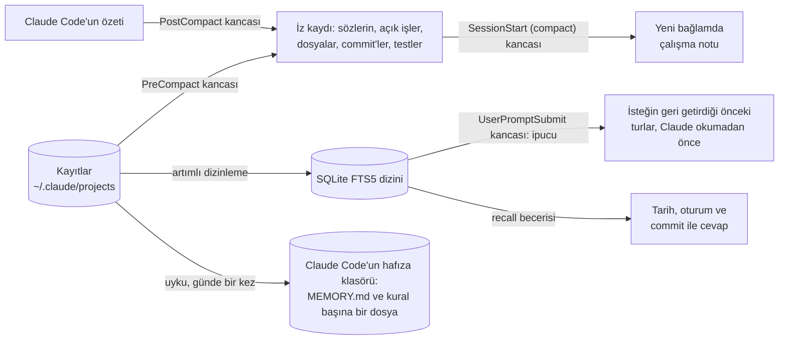

# Claude Code için LR Memory

[](https://github.com/cihanatak/lr-memory/actions/workflows/tests.yml)

[English](README.md)

Uzun Claude Code oturumları, sohbet özetlenince işin ipini kaybeder. Her yeni oturum eskilerden habersiz başlar ve geçen hafta yaptığın bir düzeltmeyi yeniden yapman gerekir. LR Memory üçünü de çözer:

1. **Özetlemeyi aşan çalışma notu.** Claude Code sohbeti özetlemeden hemen önce bir kanca kaydı okur. Özetlerin en çok kaybettiklerini saklar: son mesajlarının birebir hâli, açık işler, değişen dosyalar, commit'ler ve son test sonuçları. Özetlemeden hemen sonra bunlardan çıkan kısa bir not (en çok 9.000 karakter) tam kayda giden yolla birlikte yeni bağlama geri konur.
2. **İpucu: önceki turlar kendiliğinden geri gelir.** Claude isteğini okumadan önce bir kanca, bu projenin önceki oturumlarında isteğin sözcükleriyle arama yapar. Geri getirdiği turlar, her biri senin söylediğin ve verilen cevapla birlikte, birebir Claude'un önüne konur: en çok üç tur, her biri oturum başına bir kez. Geçen hafta verdiğin bir gerekçe ya da Claude'un dün ölçtüğü bir sayı, kimsenin aramayı akıl etmesine gerek kalmadan oradadır.
3. **Bütün geçmiş oturumlarda arama.** Claude Code'un `~/.claude/projects` altında tuttuğu bütün kayıtlar için yerel bir arama dizini: senin mesajların, Claude'un cevapları, commit'ler, komutlar, özetler, alt ajan raporları ve hafıza dosyaları. `recall` becerisi, daha önce yapılmış bir şeyi yeniden yapmadan ya da tahmin etmeden önce Claude'a bu dizinde aratır. Cevap tarih, oturum ve commit ile gelir.
4. **Uyku: kendi sözlerin hafızaya döner.** Açarsan günde bir kez, ya da her `/lr-memory:sleep` çalıştırdığında, bir geçiş her projede son geçişten beri söylediklerini okur. Verdiğin kalıcı kurallar, düzeltmeler ve bilgiler, geçerken andığın bir sınır bile, Claude Code'un kendi hafıza klasörüne yazılır; sonraki her oturum onu yükler. Olan bir şeyden çıkarılan ders ise başka bir geçiş onu yeni bir kanıtla destekleyene kadar bekler.

Not, ipucu ve arama için sunucu, ağ ya da model çağrısı gerekmez. Modeli çağıran tek parça uykudur: yeni mesajı olan her proje için bir kez, yalnız sen çalıştırınca ya da açınca. Hepsi Python'un standart kütüphanesi, dört kanca ve iki beceriden oluşur.

## Kurulum

Claude Code içinde:

```
/plugin marketplace add cihanatak/lr-memory
/plugin install lr-memory@living-runtime
```

Ardından Claude Code'u yeniden başlat. Kancalar açılışta yüklenir.

**Gerekenler:**
- Claude Code. 2.1.235 ve 2.1.308 ile denendi.
- `PATH` üzerinde `python3`, `python` ya da `py` adıyla Python 3.9 veya üstü.
- `sh`. macOS ve Linux'ta zaten var. Windows'ta Claude Code kancaları Git Bash ile çalıştırır ve `sh` oradan gelir.
- Uyku için `PATH` üzerinde, terminalden oturumu açılmış `claude` komutu: `claude` çalıştır, ardından `/login`. Uyku kendi `claude`'unu başlatır ve içinden çalıştığı oturumun girişini ödünç alamaz; Claude Code o girişi araçlara ve kancalara verdiği kabuktan çıkarır. Claude Code'u yalnız Claude masaüstü uygulamasında kullanıyorsan bu girişi bir kez yap.

## Kullanım

- **Not** senden bir şey istemez. Her özetlemeden sonra kendiliğinden gelir; otomatik özetlemede de `/compact` ile de.
- **İpucu** da senden bir şey istemez. Aynı projenin önceki bir turuyla en az üç sözcüğü ortak olan bir istek o turu geri getirir; kısa ya da ilgisiz bir istek bir şey getirmez. Bir şey bulduğunda bağlama birkaç yüz token ekler. Kapatmak için `LR_MEMORY_CUE` değişkenini `off` yap.
- **Hatırlama** için geçmişi kendi sözlerinle sorman yeter:
  - "Geçen sefer giriş yönlendirmesini nasıl düzeltmiştik?"
  - "Önbellek anahtarını hangi commit değiştirdi?"
  - "Yeniden deneme sınırında ne karar vermiştik?"

  Claude kayıtta arar, uyan konuşmayı açar ve kaynağıyla cevap verir. Bir şey bulamazsa tahmin etmez, bulamadığını söyler.
- **Kabuktan kullanmak** istersen, bu makinedeki tam komut notun içinde yazar. Biçimi şöyledir:

  ```bash
  sh <eklenti klasörü>/scripts/run.sh search staging proxy port
  sh <eklenti klasörü>/scripts/run.sh show 3f2a9c1e:5852
  ```

  Aramayı daraltmak için `--kind user,commit`, `--since 2026-10-20`, `--session 3f2a9c1e` ya da `-k 5` kullanılır.
- **Uyku** sen isteyince çalışır:
  - `/lr-memory:sleep` hemen bir geçiş yapar. Neyin yazıldığını, neyin beklediğini ve neyin reddedildiğini, maliyetiyle birlikte token olarak bildirir.
  - `/lr-memory:sleep --dry-run` aynısını gösterir ama hiçbir şey yazmaz.
  - Kendiliğinden günde bir kez çalışması için `LR_MEMORY_SLEEP` değişkenini `daily` yap. O zaman 20 saatten sonraki ilk oturum açılışı arka planda bir geçiş başlatır.
  - Her rapor `~/.claude/lr-memory/sleep/reports/` altında saklanır.

## Nasıl çalışır



**Tasarım kararları:**
- **Birebir, yeniden yazılmış değil.** Özet ana fikri korur. Ama "eski göçe dokunma" gibi bir düzeltme genel bir cümleye döner, dosya ve commit izleri de ilk gidenlerdir. Not bunları kayıttan mekanik olarak alır.
- **Kaydın kopyası değil, kayda bir dizin.** Kaynak her zaman kayıtların kendisidir. Arama, her biri kaynağıyla birkaç kısa sonuç döndürür; model gerekeni açar.
- **Aranmadan geri gelir.** Oturumlar arası deney düzeninde recall becerisi 13 oturumda yüklüydü ve hiçbirinde kullanılmadı: neyi kaçırdığını bilmeyen model onu aramaz. İpucu bu aramayı her istekte kendisi yapar, tıpkı bir ipucunun bir anıyı geri getirmesi gibi. Yalnız bu projenin oturumlarında arar. Turları BM25 ile sıralar; böylece isteğin sıradan sözcüklerinden çoğunu paylaşan uzun bir cevap, nadir sözcüklerini paylaşan kısa bir mesajın önüne geçmez. İsteğin sözcüklerinden üçünden azını paylaşan tur dışarıda kalır.
- **Hafif kök bulmalı düz sözcük araması.** Gömme, vektör deposu ya da sunucu gerekmez. Harfler katlanır (ı→i, ş→s, aksanlar düşer) ve her sorgu sözcüğü ilk beş harfine indirilir. Türkçede bu, tam bir kök bulucu kadar iyi çalışır (Can ve ark., JASIST 2008). Böylece `düzeltmiştik` aranınca `düzeltme` de bulunur; İngilizcede `comparator` aranınca `compare` bulunur. Sözcüğün tamamını taşıyan sonuç, yalnız kesik biçimi taşıyanın önüne geçer. Parçalardan oluşan bir ad (`listed_commits`, `predict.py`) bütün olarak eşleşir.
- **Asla yol kesmez.**
  - Hata veren bir kanca 0 ile çıkar ve `errors.log`'a yazar; özetlemeyi ya da oturum açılışını hiç durdurmaz.
  - Her arama önce yalnız son aramadan beri eklenenleri dizinler, en yeni oturumlardan başlayarak. Uzun bir geçmişte ilk arama 40 saniye sonra dizinlemeyi bırakır ve ne kadar kaldığını söyler.
  - Arama, içinde bulunulan oturumun son özetlemeden beri söylediklerini dışarıda bırakır. Onlar zaten bağlamdadır; yoksa az önce sorulan soru ilk sonuç olarak geri gelirdi.
  - Oturum açılışında dizin arka planda güncellenir.
- **Anahtarlar dışarıda kalır.** Anahtar biçimli dizgiler dizine girmeden maskelenir: Anthropic, OpenAI, GitHub, AWS, Google, Slack, Hugging Face anahtarları ve özel anahtarlar. Bir arama asla anahtar yazdıramaz.
- **Uyku yalnız kaydın desteklediğini yazar.**
  - Her öneri ya senin sözlerini birebir alıntılar ya da bu oturumlardaki bir commit'i gösterir. Gösterdiği mesajda geçmeyen bir alıntı düşer; anahtara ya da parolaya benzeyen her şey de düşer.
  - Açıkça söylediğin her şey aynı gün yazılır: kalıcı bir kural, tercih ya da yasak; ya da sonraki işin bilmesi gereken bir bilgi, örneğin bir sınır, bir sayı ya da bir kararın gerekçesi, geçerken andığın biri bile.
  - Olan bir şeyden çıkarılan ders önce aday olarak bekler; hiçbir oturum onu görmez. Başka bir geçiş onu daha önce olmayan bir kanıtla desteklerse kurala döner. 14 gün içinde yeniden desteklenmeyen aday söner; sonraki kanıtın çürüttüğü aday geri çekilir. Yeniden oynatma yanlış bir genellemeyi de doğrusu kadar kolay güçlendirir: LR'de bir kez yanlış okunmuş tek bir ölçüm, altmış kat yanlış bir kurala dönmüştü.
  - Güncelleme tarihli bir başlıkla sona eklenir, hiçbir şeyi yeniden yazmaz. Bir kural yalnız senin sözlerinle emekliye ayrılır ve `memory/_retired/` altına taşınır. Her dosya değişmeden önce yedeklenir.
  - Var olan bir kuralın zaten söylediği bir şeyi yeniden söylemek zorunda kaldıysan, rapor o kuralın adını verir: o kural tutmamıştır.
  - Yapıştırılan metin senin sözün değildir, dışarıda kalır.
- **Uyku yol kesmez.**
  - Başlattığı `claude -p` boş bir klasörde çalışır: araç yok, MCP sunucusu yok, kanca yok, oturum kaydı yok.
  - Bir oturum projenin `MEMORY.md` dosyasına yazarken ya da Claude Code'un kendi hafıza birleştirmesi orada çalışırken o projeyi atlar.
  - Claude Code'un `autoMemoryEnabled` ve `autoMemoryDirectory` ayarlarına uyar.

## Yazarın makinesinde ölçülenler

- **1. gün bir kez söylenen, 2. gün gereken.** [Oturumlar arası deney düzeninde](bench/cross_session/DESIGN.md) 1. gün altı mesajlık bir iştir; 2. gün ise ona dayanan üç görevli yeni bir oturumdur. Bütün kollarda Claude Code'un kendi hafızası açıktı; Sonnet 5.5, beş zincir, her kol için aynı 1. gün.
  - Tek başına Claude Code kalıcı kuralları korudu. Beş zincirin hepsinde bir vergi oranının neden düzeltildiğini ve kendi ölçtüğü taban değeri kaybetti, ikisini de kullanıcıya sordu.
  - LR Memory 0.3.0 ile gerekçe beş zincirin hepsinde koda, taban değer de rapora geçti. Yedi hafıza ve kural kontrolünde, tek başına Claude Code'un kaldığı yerde 10 kez geçti, tersi bir kez oldu (işaret testi, p = 0,012). Uyku kapalıyken ipucu tek başına 3 zincirin 3'ünde aynısını yaptı. İpucu ilk zincirin kaydına bakılarak tasarlandı; diğer dördü dışarıda tutuldu.
  - 2. günün tokenları koşular arasındaki oynamanın içinde kaldı: zincir zincir %28 daha azdan %4 daha fazlaya, ortanca %0.
  - Çözülmeyen: hiçbir kol, cevaplarının uzunluğundan yakınılmasından sonra kısa yazmadı. İpucu olmayan LR Memory 0.2.0 iki bilgiyi beş zincirin ikişerinde taşıdı.
  - [İkinci bir iş](bench/cross_session/kargo/DESIGN.md), içindeki hiçbir şey ipucuna göre ayarlanmadan kuruldu: Türkçe bir mağazanın kargo modülü; mesajları, ipucunun sözcükleri nasıl eşleştirdiğini bilmeyen bir alt ajan yazdı; üç zincir. LR Memory 0.3.0 ile ölçülen sayı da gerekçe de üç zincirin hepsinde geri geldi. Tek başına Claude Code sayıyı hiçbirinde yazmadı, gerekçeyi ise yalnızca 1. günün onu depoya koyduğu yerde yazdı (7 kazanç, 1 kayıp, p = 0,07; ilk işin dışarıda tutulan zincirleriyle birlikte 15'e 2, p = 0,002).
  - İpucunun taşımadığı: başka bir konunun içinde lafın arasında söylenmiş bir API hız sınırı. Ona ihtiyaç duyan sonraki görevle ortak sözcüğü yok. Uyku geçişi onu 3 zincirin 1'inde taşıdı. İkinci işte 2. gün LR Memory ile %18 ile %94 arasında daha pahalıydı: tek başına Claude Code dünkü sayıyı bilmediği için günün raporunu yazmak yerine üç zincirde de onu sordu.
  - [Üçüncü bir iş](bench/cross_session/shelf/DESIGN.md), LR Memory 0.3.1 için. Bu sürümde uyku geçişi kullanıcının açıkça söylediğini, lafın arasında söylenmiş bir bilgi de olsa, aynı gün yazar. İş bir kütüphanenin ödünç verme yazılımı; üç zincir; 0.3.1 kurulurken hiçbir parçası görülmedi. 1. gün kullanıcı, başka bir konudaki mesajın içinde, gişedeki etiket yazıcısının yalnızca düz ASCII bastığını söyler; 2. gün sırt etiketleri istenir ve yazıcıdan hiç söz edilmez. Uyku geçişi bu sınırı üç zincirin hepsinde hafızaya yazdı ve etiketler düz ASCII çıktı. Tek başına Claude Code üçünde de aksanlı harfleri bastı. Gerekçe ve ölçülen sayı da 3 zincirin 3'ünde geri geldi, tek başına Claude Code'da hiçbirinde. Altı hafıza ve kural kontrolünde 13 kazanç, hiç kayıp yok (p = 0,0002). Claude Code'un kendi hafızası iki zincirde 1. gün hiçbir şey yazmadı; o zincirlerde 2. gün, lobideki kioskun çağırdığı bir işlevin adını değiştirdi. Aynı 1. gün kaydında uyku geçişi tek başına bu sınırı 0.3.1 ile 9 geçişin 9'unda yazdı, 0.3.0 ile 4'ünde; 0.3.0 kalan 5'inde onu aday olarak bekletti.
- **Dizin:** 575 kayıt (6,6 GB) sıfırdan 41 saniyede dizinlendi: 77.471 parça, 129 MB'lık bir dizin. Sonrasında bir arama, Python'un açılışı dahil yaklaşık yarım saniye sürüyor.
- **Arama çıktısı:** bir arama 0,4–1,2 KB yazar, yani birkaç yüz token. Aynı sözcükler için ham `.jsonl` dosyalarında grep 0,3–4,5 MB yazdı.
- **Token yükü:** uzun oturumlarla geçen bir günde 1.108 model çağrısında 586 milyon token okundu; çağrı başına ortanca 543.000. Her tur bütün bağlamı yeniden okur, bu yüzden uzun bağlam her turda maliyet çıkarır.
  - Claude Code'un özetleme penceresini düşürmek (`settings.json` içinde `"autoCompactWindow": 400000`) her turu ucuzlatır. [Uzun oturum deney düzeninde](bench/long_session/README.md) Sonnet 5.5 ile yapılan on mesajlık bir iş, 100k pencereyle 1M pencereye göre %24–27 daha az token harcadı. Dokuz koşunun hepsi 16 kontrolün 16'sını da geçti.
  - Notun orada ölçülebilir bir etkisi olmadı. O iş için Claude Code'un kendi özeti yetti; yani bu deney, notun özetlemeyi daha güvenli kıldığını göstermiyor.
  - İşi ertesi güne taşıyan arama oldu. Yeni oturumlara önceki oturumla ilgili üçer soru soruldu: LR Memory'li dokuz oturum 27 sorunun 27'sini, LR Memory'siz dokuz oturum 10'unu doğru cevapladı. Bir oturum iki durumda da yaklaşık 49.000 token tuttu.
- **Uyku:**
  - Altı mesajlı ve bir commit'li bir projede geçiş Sonnet 5.5 ile 9 saniye sürdü ve 3.631 token harcadı. Her biri bir alıntıya dayanan üç değişiklik yaptı: iki yeni kural ve kullanıcının yeniden söylemek zorunda kaldığı kurala bir ek. Rapor o kuralın adını verdi.
  - Yazarın kendi makinesinde ilk geçiş, günün 979 MB'lık kayıtlarından 38 mesaj okurdu; bu okuma 2,5 saniye sürüyor. İstemi yaklaşık 26.000 token olurdu; bunun çoğu, orada zaten duran 410 hafıza dosyasının tek satırlık açıklamaları.

## Ayarlar

Bunlar ortam değişkeni olarak verilir, örneğin `~/.claude/settings.json` içinde `"env"` altında:

| Değişken | Varsayılan | Anlamı |
| --- | --- | --- |
| `LR_MEMORY_LANG` | otomatik | `en` ya da `tr`. Otomatik seçim, mesajların Türkçe görünüyorsa Türkçe yazar. |
| `LR_MEMORY_DATA` | `~/.claude/lr-memory` | Dizinin ve iz kayıtlarının tutulduğu yer. |
| `LR_MEMORY_TRANSCRIPTS` | `~/.claude/projects` | Kayıtların okunduğu yer. |
| `LR_MEMORY_CUE` | açık | `off` ipucunu kapatır. |
| `LR_MEMORY_SLEEP` | kapalı | `daily`, 20 saatten sonraki ilk oturum açılışında bir uyku geçişi başlatır. |
| `LR_MEMORY_SLEEP_MODEL` | varsayılan modelin | Uykunun modeli, örneğin `sonnet` ya da `opus`. |
| `LR_MEMORY_CLAUDE` | `PATH` üzerindeki `claude` | Uykunun çalıştırdığı `claude` komutu. |

`CLAUDE_CONFIG_DIR` verilmişse ona uyulur.

## Gizlilik ve kaldırma

Not, ipucu ve dizin senin makinende kalır. Dizin, anahtarları maskelenmiş olarak yalnız senin kayıtlarındaki metni tutar. Uyku, okuduğu mesajları anahtarları maskelenmiş olarak, her oturumun yaptığı gibi kendi Claude Code girişinle modele gönderir.

Kaldırmak için önce `/plugin uninstall lr-memory@living-runtime` çalıştır, ardından `~/.claude/lr-memory` klasörünü sil. Bu klasörde dizin, iz kayıtları ve uykunun raporları, adayları ve yedekleri durur. Uykunun yazdığı hafıza dosyaları Claude Code'un hafıza klasöründe kalır; onları da diğerleri gibi düzenleyebilir ya da silebilirsin.

## Geliştirme

```bash
python -m pytest tests
```

Testler yalnız geçici klasörler kullanır. Gerçek `~/.claude`'u hiç okumaz, Claude'u başlatmaz ve ağa çıkmaz.

## COL, buradaki öbür eklenti

Bu pazaryerinde LR Memory'den bağımsız ikinci bir eklenti var. **COL** dört iş yapar:
- Claude'un son mesajını gerçekten çalışanla karşılaştırır: andığı commit var olmalı, verdiği dosya diskte olmalı, söylediği test sayısı gerçek test çıktısında geçmeli.
- Uzun işlerden ve geri alınamayan adımlardan önce ölçülebilir öngörülerden bir defter tutar ve onları sonuçlarla karşılaştırır.
- Bir anahtar taşıyacak commit'i ya da push'u durdurur.
- Bir kontrol, bir düzenlemeden sonra yine aynı şekilde düşerse iki rakip açıklama ve onları ayırt eden tek bir komut ister. Ölçülen etkisi [deney düzeninde](bench/README.md); etki küçük.

Yereldir, hiç model çağırmaz.

```
/plugin install col@living-runtime
```

Ayrıntılar: [plugins/col/README.tr.md](plugins/col/README.tr.md).

LR Memory, yazarın ajan çalışma ortamı LR'den (Living Runtime) ayrıldı. Orada Ekim 2026'dan beri çalışıyor.

## Lisans

MIT
