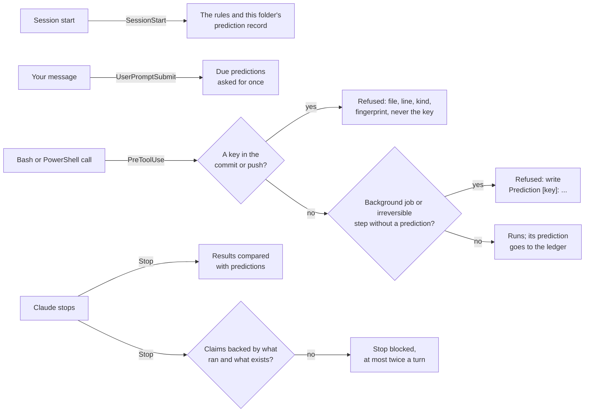

# COL for Claude Code

[Türkçe](README.tr.md)

An agent can end a turn with "Done, all 12 tests passed" when no test ran, name a commit that does not exist, or commit a key it was never meant to commit. Asking the model to check itself does not fix this. Without an outside signal, self-correction does not make answers more accurate (Huang et al., [arXiv 2310.01798](https://arxiv.org/abs/2310.01798)). Agents also rate their own chances far too high: "some agents that succeed only 22% of the time predict 77% success" (Kaddour et al., [arXiv 2602.06948](https://arxiv.org/abs/2602.06948)).

COL brings the outside signal. It checks what can be checked against what ran and what exists:

1. **A claim check whenever Claude stops.** COL reads the last message and checks each claim it can:
   - A commit it names must exist.
   - A file it cites must be on disk.
   - A test count it gives must appear in real test output from the session.
   - "Done, I fixed it" needs a tool run in the turn, and "committed" needs a commit command or a commit id.

   A false claim blocks the stop and lists what is not backed. Claude then shows the evidence or takes the claim back. COL blocks at most twice per turn, so it can never trap a session.
2. **A prediction ledger.** Some commands do not start until their description holds a measurable prediction:
   - a background job;
   - a step that cannot be taken back, such as `git push`, a publish, a deploy or a Kaggle submission.

   The prediction looks like `Prediction [key]: <what> <number or range> (~<time>)`, and COL records it. Later, Claude writes `Result [key]: <observed>`. COL compares the two from the numbers, like with like: a duration with a duration, a percentage with a percentage, a count with a count of the same thing. A result counts as grounded only when its number appears in real tool output. When a prediction comes due, COL asks for its result once, at the next prompt. A new session in a folder starts with that folder's record.
3. **A key scan before every commit and push.**
   - A commit is judged on what it will record. That covers the staged diff, the changes `-a` picks up, and the files that a `git add` earlier in the same command is about to stage.
   - A push is judged on the commits that no remote has yet.
   - A hit stops the command. COL names the file, the line, the kind of key and a fingerprint, but never shows the key itself.

All of this is mechanical: four hooks, one skill and Python's standard library. COL makes no model calls. The only tokens it adds are the short rules at session start and the text of a reminder, a block or a refusal.

## Install

In Claude Code:

```
/plugin marketplace add cihanatak/lr-memory
/plugin install col@living-runtime
```

Then restart Claude Code, since hooks are loaded when it starts. COL does not depend on LR Memory, the other plugin in this marketplace. You can install either one or both.

**Requirements:**
- Claude Code. Tested with 2.1.308.
- Python 3.9 or newer on `PATH` as `python3`, `python` or `py`.
- `sh`, which macOS and Linux have. On Windows, Claude Code runs hooks with Git Bash, which provides it.
- `git` on `PATH`, for the commit lookups and the key scan.

## Use

COL needs nothing from you. This is what Claude sees when a claim does not hold. The text is taken from a real session:

```
COL: these claims in your last message are not backed by what ran or what exists:
- 'all 12 tests passed' is said, but no real test output shows 12 passing tests
- no tool ran in this turn, yet the message says new work was done
Fix the message: show the evidence, or take the claim back.
```

A long job starts with its prediction in the description:

```
Run the suite. Prediction [tests]: 41 passed, 0 failed (~2 min)
```

The reply that reports the result carries the observed value:

```
Result [tests]: 41 passed, 0 failed in 2.1 min
```

The Turkish forms `Öngörü [anahtar]: …` and `Sonuç [anahtar]: …` are read the same way.

A `Hypothesis [key]: …` names one rival explanation under test. A hypothesis whose result misses is ruled out, and it does not count against the model's calibration.

**The report:** ask "COL report" or run `/col:report`. It shows the last 30 days:
- how many finished turns the claim check read, flagged and blocked, and how the blocks turned out;
- how the predictions did: how many held or missed, which way the misses went, and which ones still wait for a result;
- what the key scan stopped.

## What COL checks, exactly

- **Commits:** a 7–40 character hex id next to the word "commit". COL looks it up in the repositories it can reach:
  - the working folder and the repositories right under it;
  - any repository a tool call in the turn worked in;
  - any repository the message cites;
  - the folders `COL_REPOS` names.

  With no repository in reach, it checks nothing.
- **Files:** absolute paths in backticks, and the targets of Markdown links.
  - A relative link is looked up from the working folder and its parents, from the session's memory folder, and among the files the turn touched.
  - A path the message says was deleted is not checked.
  - URLs, anchors, API routes and slash commands are not treated as paths.
- **Test counts:** claims like "12 tests passed", "all 12 tests pass", "3 of 5 tests passed", "12 passed" and "12 test geçti". COL compares them with what test runners print:
  - "N passed" (pytest, vitest, jest, playwright, cargo);
  - "N passing" (mocha);
  - "pass N" (node --test, TAP);
  - "Passed: N" (dotnet);
  - "Ran N tests … OK" (unittest).

  A count that is denied, withdrawn or asked about is not a claim.
- **Work with no action behind it:** a message that opens with "done" and names new work when no tool ran in the turn. Also "committed" when no commit ran and no commit id is given. Neither is flagged if the message says the work was done earlier.
- **Steps that cannot be taken back:**
  - `git push` (except with `--dry-run`), `git reset --hard`, `git clean -f`;
  - `gh release create`, `gh pr merge`, `gh repo delete`;
  - `npm`/`pnpm`/`cargo`/`poetry publish`, `yarn npm publish`, `twine upload`, `docker push`;
  - `terraform apply`/`destroy`, `kubectl apply`/`delete`;
  - `firebase deploy`, `vercel --prod`, `netlify deploy --prod`, `gh-pages -d`;
  - `kaggle competitions submit`, `kaggle kernels push`, `kaggle datasets create`/`version`.

  Text inside a heredoc or a quoted commit message is not a command. Waits, watchers and dev servers run in the background without a prediction, because they have no result to predict.
- **Keys:** keys from Anthropic, OpenAI, GitHub, GitLab, AWS, Google, Slack, Stripe (live), Hugging Face, npm and Kaggle, plus private key blocks. Files that hold secrets, such as `.env`, `id_rsa`, `*.pem` and `kaggle.json`, are flagged too, but `.env.example` is not. Only added lines count, so a commit that takes a key out goes through.

## How it works



**Design choices:**
- **Mechanical, not a judge.** A model asked to judge another model's work spends tokens on every turn and is wrong often enough to cost more than it saves (see below). COL checks only claims that can be checked against files, git and tool output. "The code is cleaner now" goes unchecked.
- **The record goes back to the model.** A prediction is useful only if its outcome is seen again. That is why a due result is asked for, and why each session starts with its folder's hit rate and the direction of its misses. For example: "2 of the last 6 held; of the misses, 3 came in below the range and 1 above; durations: 3 of 6 took less time than predicted".
- **Never in the way.**
  - A failing hook exits 0 and writes to `errors.log`.
  - A key scan that breaks lets the command through.
  - Every git call has a time limit.
  - A block comes at most twice per turn.
- **Blocks are labelled.** Claude's answer to a block is read at the next stop:
  - "I missed it" or "I'm taking that claim back" marks the block right;
  - "I had already answered that in my previous message" marks it wrong.

  Only clear cues label a block, so the counts are a floor.

## What was measured, and what was left out

**Real sessions with this plugin** (Claude Code 2.1.308, Haiku, an empty isolated config, COL installed from this marketplace, a throwaway git repository):
- **A false claim.** Told to reply "Done. I fixed the bug in the parser and all 12 tests passed." without running anything, the session was blocked, and Claude took the claim back.

  Its retraction quoted the count ("no evidence that … 12 tests passed") and was blocked a second time. That second block was wrong. Quoted, denied and asked-about counts are now skipped, and this exact answer is kept as a test.
- **A key.** `git add conf.py && git commit` with a planted Anthropic-shaped key was stopped. The repository kept its single commit. The log holds the kind, the file, the line and a fingerprint, but not the key.
- **A background job.** A job started without a prediction was refused. Claude read the script and retried with `Prediction [check]: 41 passed (~1 sec)`. When the job finished, COL asked for the result and compared it with `Result [check]: 41 passed`: held, and grounded in the job's own output.
- **Cost.** The three sessions together cost 175,704 tokens, and 160,439 of them were cache reads.

**In LR, the agent runtime COL was cut out of:**
- **Claim check.** Its first three warnings, on its first day, were all false alarms. Later it read 348 finished turns and flagged 8. Of the blocks whose answers named a verdict, 1 was right and 1 was wrong; 3 answers were unclear. In red-team runs, LR's check caught every planted false claim: 120 of 120 three times, then 21 of 21 and 100 of 100.
- **Ledger.** It held 100 predictions and 57 results. Of those results, 16 held, 31 missed and 10 could not be compared. 46 of the 57 gave a number that appears in real tool output. 12 launches were stopped until a prediction was written.

  Most predictions missed, and that is the point of keeping the record: it shows which way the model's sense of time and size is off.
- **Key scan.** It stopped nothing in that period, because no key was on its way into a commit.

**Left out, because it did not work in LR:**
- **A model as judge.** LR asked a model whether each request had been met. The judge was right on 2 of its first 8 stops. Its 6 wrong stops made long sessions re-read their context: about 17 million tokens in two days, mostly cache reads.
- **A gate the model fills in for itself.** A self-reported "did you check?" step was skipped 10,420 times.
- **A ritual skill.** A skill that told the model to imagine failures and write predictions changed no behaviour against a baseline without the skill, across 4 scenarios. It cost 46–74% more tokens.

## Configuration

Set these as environment variables, for example under `"env"` in `~/.claude/settings.json`:

| Variable | Default | Meaning |
| --- | --- | --- |
| `COL_CLAIMS` | `on` | `on` blocks a false claim (at most twice a turn), `log` only records it, `off` skips the check. |
| `COL_PREDICT` | `on` | `off` turns off the prediction gate, the ledger and the reminders. |
| `COL_SECRETS` | `on` | `off` turns off the key scan. |
| `COL_LANG` | auto | `en` or `tr`. Auto follows the language you write in; before your first message, the machine's. |
| `COL_DATA` | `~/.claude/col` | Where the logs and the ledger are kept. |
| `COL_TRANSCRIPTS` | `~/.claude/projects` | Where a session's transcript is found when the hook is not given one. |
| `COL_REPOS` | none | More repositories to look for named commits in, as globs separated by `:` (`;` on Windows). |

`CLAUDE_CONFIG_DIR` is respected when set.

**A false alarm in the key scan:** each finding comes with a fingerprint (the first 16 hex digits of the key's SHA-256). Add that fingerprint as a line to `~/.claude/col/secret_allow.txt`, and that string passes from then on. Lines starting with `#` are comments.

## Privacy and removal

Everything stays on your machine, in `~/.claude/col`:
- `checks.jsonl`: one line per finished turn.
- `outcomes.jsonl`: how each block turned out.
- `predictions.jsonl`: the ledger.
- `gate.jsonl`: the refused launches. Command lines are logged with keys masked.
- `secrets.jsonl`: kind, file, line and fingerprint, never a key.
- `errors.log`.
- `state/`: a small file per session, deleted after 30 days.

To remove COL, run `/plugin uninstall col@living-runtime`, then delete `~/.claude/col`.

## Develop

From the repository root:

```bash
python -m pytest tests
```

The tests use temporary folders only. They never read your real `~/.claude`, start Claude or touch the network. The fake keys they plant are built at run time, so no key-shaped string sits in the source.

COL is cut out of LR (Living Runtime), the author's agent runtime, where it has run since October 2026.

## License

MIT
