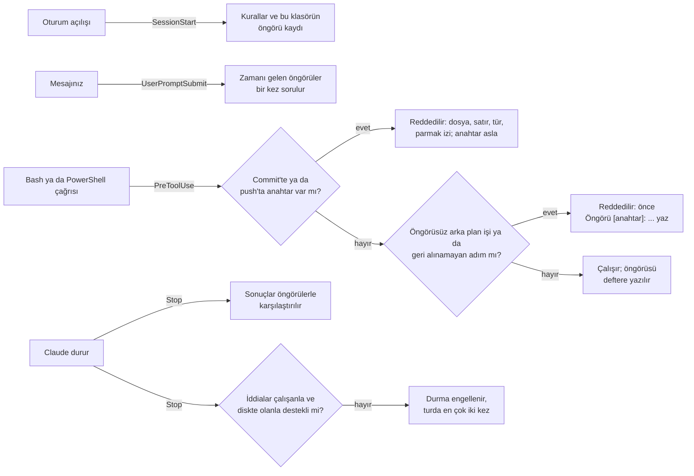

# Claude Code için COL

[](https://github.com/cihanatak/lr-memory/actions/workflows/tests.yml)

[English](README.md)

Bir ajan, hiçbir test çalışmamışken turu "Tamam, 12 testin hepsi geçti" diye bitirebilir. Var olmayan bir commit'ten söz edebilir ya da commit'lememesi gereken bir anahtarı commit'leyebilir. Modelden kendini denetlemesini istemek bunu çözmüyor. Dışarıdan bir işaret olmadan kendi kendini düzeltmek cevapları daha doğru yapmıyor (Huang ve ark., [arXiv 2310.01798](https://arxiv.org/abs/2310.01798)). Ajanlar kendi başarı şanslarını da fazlasıyla yüksek görüyor: zamanın yalnız %22'sinde başaran bazı ajanlar %77 başarı bekliyor (Kaddour ve ark., [arXiv 2602.06948](https://arxiv.org/abs/2602.06948)).

COL o dış işareti getirir. Denetlenebilecek her şeyi, gerçekten çalışan araçlara ve diskte olana karşı denetler:

1. **Claude her durduğunda iddia kontrolü.** COL son mesajı okur ve denetleyebildiği her iddiaya bakar:
   - Andığı commit var olmalı.
   - Verdiği dosya diskte olmalı.
   - Söylediği test sayısı oturumdaki gerçek test çıktısında geçmeli.
   - "Tamam, düzelttim" için turda bir aracın çalışmış olması gerekir; "commit'lendi" için de bir commit komutu ya da commit kimliği.

   Yanlış bir iddia durmayı engeller ve desteklenmeyenleri sıralar. Claude ya kanıtı gösterir ya da iddiayı geri alır. COL bir turda en çok iki kez engeller, yani bir oturumu asla kapana kıstırmaz.
2. **Öngörü defteri.** Bazı komutlar, description alanında ölçülebilir bir öngörü olmadan başlamaz:
   - arka plan işleri;
   - geri alınamayan adımlar: `git push`, paket yayımlama, dağıtım ya da Kaggle gönderimi gibi.

   Öngörü `Öngörü [anahtar]: <ne> <sayı ya da aralık> (~<süre ya da saat>)` biçimindedir; COL onu kaydeder. Sonra Claude `Sonuç [anahtar]: <gözlenen>` yazar. COL ikisini sayılardan, aynı türü aynı türle karşılaştırır: süreyi süreyle, yüzdeyi yüzdeyle, bir sayımı aynı şeyin sayımıyla. Bir sonucun sayısı gerçek araç çıktısında geçiyorsa sonuç kanıtlı sayılır. Bir öngörünün zamanı gelince COL sonucunu bir sonraki mesajda bir kez sorar. Bir klasörde açılan yeni oturum, o klasörün geçmiş kaydıyla başlar.
3. **Her commit ve push öncesinde anahtar taraması.**
   - Bir commit, kaydedeceği şeye göre değerlendirilir. Buna sahnedeki değişiklikler, `-a`'nın alacağı değişiklikler ve aynı komutta daha önce gelen bir `git add`'in sahneye koymak üzere olduğu dosyalar girer.
   - Bir push, henüz hiçbir uzak depoda olmayan commit'lere göre değerlendirilir.
   - Bir anahtar bulunursa komut durur. COL dosyayı, satırı, anahtarın türünü ve bir parmak izini söyler; anahtarın kendisini asla göstermez.

Bunların hepsi mekaniktir: dört kanca, bir beceri ve Python'un standart kütüphanesi. COL hiç model çağırmaz. Eklediği tek token, oturum başındaki kısa kurallar ile bir hatırlatmanın, engellemenin ya da reddin metnidir.

## Kurulum

Claude Code içinde:

```
/plugin marketplace add cihanatak/lr-memory
/plugin install col@living-runtime
```

Ardından Claude Code'u yeniden başlatın; kancalar açılışta yüklenir. COL, bu pazaryerindeki öbür eklenti olan LR Memory'ye bağlı değildir. İkisinden birini ya da ikisini birden kurabilirsiniz.

**Gerekenler:**
- Claude Code. 2.1.308 ile denendi.
- `PATH` üzerinde `python3`, `python` ya da `py` olarak Python 3.9 veya üstü.
- `sh`. macOS ve Linux'ta vardır. Windows'ta Claude Code kancaları Git Bash ile çalıştırır, `sh` da onunla gelir.
- Commit aramaları ve anahtar taraması için `PATH` üzerinde `git`.

## Kullanım

COL sizden bir şey beklemez. Bir iddia tutmadığında Claude şunu görür. Metin gerçek bir oturumdan alındı:

```
COL: these claims in your last message are not backed by what ran or what exists:
- 'all 12 tests passed' is said, but no real test output shows 12 passing tests
- no tool ran in this turn, yet the message says new work was done
Fix the message: show the evidence, or take the claim back.
```

Türkçe yazdığınız bir oturumda COL'un iletileri de Türkçe gelir.

Uzun bir iş, öngörüsü description alanında olarak başlar:

```
Testleri koştur. Öngörü [testler]: 41 geçer, 0 düşer (~2 dk)
```

Sonucu bildiren cevap gözlenen değeri yazar:

```
Sonuç [testler]: 41 geçti, 0 düştü, 2,1 dk sürdü
```

İngilizce `Prediction [key]: …` ve `Result [key]: …` biçimleri de aynı okunur.

`Hipotez [anahtar]: …` denenen rakip açıklamalardan birini adlandırır. Sonucu tutmayan hipotez elenmiş olur ve modelin isabet kaydına hata olarak yazılmaz.

**Rapor:** "COL raporu" deyin ya da `/col:report` çalıştırın. Son 30 günü gösterir:
- iddia kontrolünün kaç biten turu okuduğu, kaçında sorun bulduğu, kaçını durdurduğu ve durdurmaların nasıl sonuçlandığı;
- öngörülerin nasıl gittiği: kaçının tuttuğu, kaçının tutmadığı, tutmayanların hangi yöne saptığı ve hangilerinin hâlâ sonuç beklediği;
- anahtar taramasının neleri durdurduğu.

## COL tam olarak neyi denetler

- **Commit'ler:** "commit" sözcüğünün yanındaki 7–40 karakterlik onaltılık bir kimlik. COL onu erişebildiği depolarda arar:
  - çalışma klasörü ve hemen altındaki depolar;
  - turdaki bir araç çağrısının çalıştığı her depo;
  - mesajın andığı her depo;
  - `COL_REPOS`'un gösterdiği klasörler.

  Erişilebilir depo yoksa hiçbir şey denetlemez.
- **Dosyalar:** ters tırnak içindeki mutlak yollar ve Markdown bağlantılarının hedefleri.
  - Göreli bir bağlantı çalışma klasöründen ve onun üst klasörlerinden, oturumun hafıza klasöründen ve turun dokunduğu dosyalar arasından aranır.
  - Mesajın silindiğini söylediği bir yol denetlenmez.
  - Adresler, sayfa içi bağlantılar, API yolları ve eğik çizgi komutları yol sayılmaz.
- **Test sayıları:** "12 tests passed", "all 12 tests pass", "3 of 5 tests passed", "12 passed" ya da "12 test geçti" gibi iddialar. COL bunları test çalıştırıcılarının yazdıklarıyla karşılaştırır:
  - "N passed" (pytest, vitest, jest, playwright, cargo);
  - "N passing" (mocha);
  - "pass N" (node --test, TAP);
  - "Passed: N" (dotnet);
  - "Ran N tests … OK" (unittest).

  Yalanlanan, geri alınan ya da soru olarak sorulan bir sayı iddia sayılmaz.
- **Arkasında iş olmayan iddia:** turda hiçbir araç çalışmamışken "tamam" diye başlayıp yeni bir iş yapıldığını söyleyen mesaj. Hiçbir commit çalışmamış ve commit kimliği verilmemişken "commit'lendi" demek de buna girer. Mesaj işin daha önce yapıldığını söylüyorsa ikisi de işaretlenmez.
- **Geri alınamayan adımlar:**
  - `git push` (`--dry-run` hariç), `git reset --hard`, `git clean -f`;
  - `gh release create`, `gh pr merge`, `gh repo delete`;
  - `npm`/`pnpm`/`cargo`/`poetry publish`, `yarn npm publish`, `twine upload`, `docker push`;
  - `terraform apply`/`destroy`, `kubectl apply`/`delete`;
  - `firebase deploy`, `vercel --prod`, `netlify deploy --prod`, `gh-pages -d`;
  - `kaggle competitions submit`, `kaggle kernels push`, `kaggle datasets create`/`version`.

  Bir heredoc'un ya da tırnak içindeki bir commit mesajının metni komut sayılmaz. Bekleme döngüleri, izleyiciler ve geliştirme sunucuları arka planda öngörüsüz çalışabilir, çünkü öngörülecek bir sonuçları yoktur.
- **Anahtarlar:** Anthropic, OpenAI, GitHub, GitLab, AWS, Google, Slack, Stripe (canlı), Hugging Face, npm ve Kaggle anahtarları, ayrıca özel anahtar blokları. `.env`, `id_rsa`, `*.pem` ve `kaggle.json` gibi gizli bilgi tutan dosyalar da işaretlenir, ama `.env.example` işaretlenmez. Yalnız eklenen satırlar sayılır, yani bir anahtarı dosyadan çıkaran commit geçer.

## Nasıl çalışır



**Tasarım kararları:**
- **Hakem değil, mekanik.** Başka bir modelin işini yargılayan bir model her turda token harcar ve yeterince sık yanılır; kazandırdığından fazlasına mal olur (aşağıya bakın). COL yalnız dosyalara, git'e ve araç çıktısına karşı denetlenebilen iddialara bakar. "Kod artık daha temiz" denetlenmez.
- **Kayıt modele geri döner.** Bir öngörü ancak sonucu yeniden görülürse işe yarar. Bu yüzden zamanı gelen sonuç sorulur ve her oturum, klasörünün isabet oranıyla ve tutmayanların yönüyle başlar. Örneğin: "son 6 öngörünün 2'si tuttu; tutmayanlardan 3'ü aralığın altında, 1'i üstünde kaldı; süreler: 6 sürenin 3'ü öngörüden kısa sürdü".
- **Asla yolu kesmez.**
  - Hata veren bir kanca 0 koduyla çıkar ve `errors.log`'a yazar.
  - Bozulan anahtar taraması komutu geçirir.
  - Her git çağrısının bir süre sınırı vardır.
  - Bir turda en çok iki engelleme olur.
- **Engellemeler etiketlenir.** Claude'un bir engellemeye verdiği cevap bir sonraki durmada okunur:
  - "atlamışım" ya da "iddiamı geri alıyorum" engellemeyi doğru diye işaretler;
  - "bunu önceki mesajımda zaten cevaplamıştım" yanlış diye işaretler.

  Yalnız açık ipuçları etiketler; bu yüzden sayılar bir alt sınırdır.

## Neler ölçüldü, neler dışarıda bırakıldı

**Bu eklentiyle gerçek oturumlar** (Claude Code 2.1.308, Haiku, boş ve yalıtılmış bir yapılandırma, COL bu pazaryerinden kuruldu, atılacak bir git deposu):
- **Yanlış iddia.** Hiçbir şey çalıştırmadan "Done. I fixed the bug in the parser and all 12 tests passed." diye cevap vermesi istendi. Oturum engellendi ve Claude iddiayı geri aldı.

  Geri alırken sayıyı andı ("no evidence that … 12 tests passed") ve ikinci kez engellendi. Bu ikinci engelleme yanlıştı. Artık alıntılanan, yalanlanan ve soru olarak sorulan sayılar atlanıyor; o cevap da birebir test olarak saklanıyor.
- **Anahtar.** Anthropic anahtarı biçiminde sahte bir anahtar konmuş `conf.py` ile `git add conf.py && git commit` durduruldu. Depo tek commit'iyle kaldı. Kayıtta tür, dosya, satır ve parmak izi var; anahtar yok.
- **Arka plan işi.** Öngörüsüz başlatılan bir iş reddedildi. Claude betiği okudu ve `Prediction [check]: 41 passed (~1 sec)` ile yeniden denedi. İş bitince COL sonucu sordu ve `Result [check]: 41 passed` ile karşılaştırdı: tuttu, kanıtı da işin kendi çıktısında.
- **Maliyet.** Üç oturum birlikte 175.704 token tuttu; bunun 160.439'u önbellekten okumaydı.

**COL'un ayrıldığı ajan çalışma ortamı LR'de:**
- **İddia kontrolü.** İlk gününde verdiği ilk üç uyarının üçü de yanlış alarmdı. Sonra 348 biten turu okudu ve 8'inde sorun buldu. Cevabı bir yargı bildiren engellemelerden 1'i doğru, 1'i yanlış çıktı; 3 cevap belirsizdi. Kırmızı takım denemelerinde LR'nin kontrolü konan her sahte iddiayı yakaladı: üç kez 120'de 120, sonra 21'de 21 ve 100'de 100.
- **Defter.** 100 öngörü ve 57 sonuç tuttu. Sonuçlardan 16'sı tuttu, 31'i tutmadı, 10'u karşılaştırılamadı. 57 sonucun 46'sı gerçek araç çıktısında geçen bir sayı verdi. 12 başlatma, öngörü yazılana kadar durduruldu.

  Öngörülerin çoğu tutmadı. Kaydı tutmanın amacı da bu: modelin süre ve büyüklük duygusunun hangi yöne saptığını gösteriyor.
- **Anahtar taraması.** O dönemde hiçbir şey durdurmadı, çünkü hiçbir anahtar bir commit'e girmek üzere değildi.

**LR'de işe yaramadığı için dışarıda bırakılanlar:**
- **Hakem olarak model.** LR, her isteğin karşılanıp karşılanmadığını bir modele sordu. Hakem ilk 8 durdurmasının 2'sinde haklıydı. 6 yanlış durdurması uzun oturumlara bağlamlarını yeniden okuttu: iki günde yaklaşık 17 milyon token, çoğu önbellekten okuma.
- **Modelin kendi doldurduğu kapı.** Modelin kendisinin işaretlediği "kontrol ettin mi?" adımı 10.420 kez atlandı.
- **Ritüel beceri.** Modele başarısızlıkları hayal etmesini ve öngörü yazmasını söyleyen bir beceri, 4 senaryoda becerisiz tabana göre hiçbir davranışı değiştirmedi. %46–74 daha fazla token harcadı.

## Ayarlar

Bunları ortam değişkeni olarak verin, örneğin `~/.claude/settings.json` içinde `"env"` altında:

| Değişken | Varsayılan | Anlamı |
| --- | --- | --- |
| `COL_CLAIMS` | `on` | `on` yanlış iddiayı engeller (turda en çok iki kez), `log` yalnız kaydeder, `off` kontrolü atlar. |
| `COL_PREDICT` | `on` | `off` öngörü kapısını, defteri ve hatırlatmaları kapatır. |
| `COL_SECRETS` | `on` | `off` anahtar taramasını kapatır. |
| `COL_LANG` | otomatik | `en` ya da `tr`. Otomatik, yazdığınız dili izler; ilk mesajınızdan önce makinenin dilini. |
| `COL_DATA` | `~/.claude/col` | Kayıtların ve defterin tutulduğu yer. |
| `COL_TRANSCRIPTS` | `~/.claude/projects` | Kancaya verilmediğinde oturum kaydının arandığı yer. |
| `COL_REPOS` | yok | Anılan commit'lerin aranacağı ek depolar; `:` ile (Windows'ta `;` ile) ayrılmış glob kalıpları. |

`CLAUDE_CONFIG_DIR` verilmişse ona uyulur.

**Anahtar taramasında yanlış alarm:** her bulgu bir parmak iziyle gelir (anahtarın SHA-256 özetinin ilk 16 onaltılık hanesi). Bu parmak izini `~/.claude/col/secret_allow.txt` dosyasına bir satır olarak ekleyin; o dizgi bundan sonra geçer. `#` ile başlayan satırlar açıklamadır.

## Gizlilik ve kaldırma

Her şey makinenizde, `~/.claude/col` içinde kalır:
- `checks.jsonl`: biten her tur için bir satır.
- `outcomes.jsonl`: engellemelerin nasıl sonuçlandığı.
- `predictions.jsonl`: defter.
- `gate.jsonl`: reddedilen başlatmalar. Komut satırları anahtarlar maskelenerek yazılır.
- `secrets.jsonl`: tür, dosya, satır ve parmak izi; anahtar asla.
- `errors.log`.
- `state/`: oturum başına küçük bir dosya, 30 gün sonra silinir.

COL'u kaldırmak için `/plugin uninstall col@living-runtime` çalıştırın, sonra `~/.claude/col` klasörünü silin.

## Geliştirme

Depo kökünden:

```bash
python -m pytest tests
```

Testler yalnız geçici klasörler kullanır. Gerçek `~/.claude`'u hiç okumaz, Claude'u başlatmaz ve ağa çıkmaz. Diktikleri sahte anahtarlar çalışma anında kurulur, yani kaynakta anahtar biçiminde bir dizgi durmaz.

COL, yazarın ajan çalışma ortamı LR'den (Living Runtime) ayrıldı. Orada Ekim 2026'dan beri çalışıyor.

## Lisans

MIT
