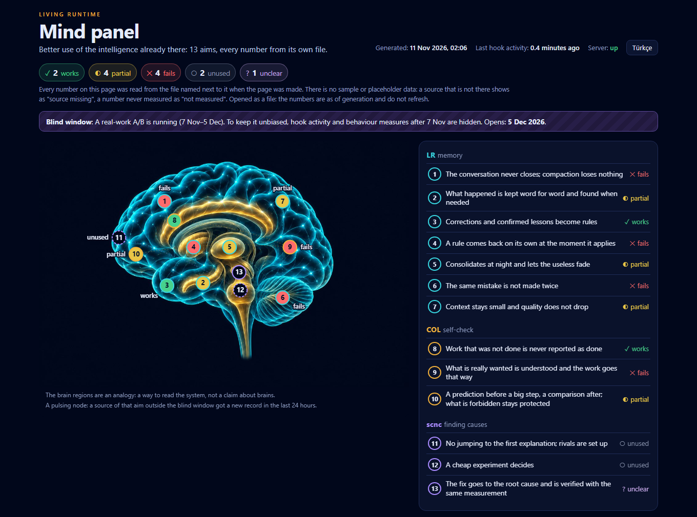

# Mind panel

[Türkçe](README.tr.md)



One local page for the Living Runtime layer on Claude Code: LR Memory (memory), COL (self-check) and scnc (finding causes). For each of [13 aims](../../docs/AIMS.md) it shows what the aim is, how it is measured, what the last measurement says, and live numbers read from your own files at the moment the page is made.

**Nothing on the page is sample data.** Every number names the file it came from and how it was computed. A source that is not there shows as "source missing". A number that was never measured shows as "not measured". An aim has a status only when you have written one, after a measurement, into a scorecard.

## Install and run

```
/plugin marketplace add cihanatak/lr-memory
/plugin install mind@living-runtime
```

Then, in Claude Code:

```
/mind:panel
```

From a shell, with the folder the plugin is installed in (or `plugins/mind` in a clone):

```bash
sh <plugin folder>/scripts/run.sh --open
```

It writes `~/.claude/mind/panel.html` and opens it. The first run reads every transcript and can take minutes; later runs read only what changed.

| Option | Meaning |
| --- | --- |
| `--open` | Open the page in the browser. |
| `--out FILE` | Where the page goes. |
| `--lang en\|tr` | The page's language; the page can also switch. |
| `--serve PORT` | Serve the page on `127.0.0.1:PORT`; the numbers refresh every minute. |
| `--scorecard FILE` | A scorecard to lay over the aims. |
| `--config FILE` | A config file instead of `~/.claude/mind/config.json`. |
| `--no-transcripts` | Skip the transcript scan. |
| `--json` | Print the collected data instead of writing the page. |

**Requirements:** Python 3.9 or newer on `PATH` as `python3`, `python` or `py`, and `sh`. It works without the other two plugins; their sources then show as missing.

## What it reads

- **COL's logs** (`~/.claude/col/*.jsonl`, or `COL_DATA`) and **LR Memory's folder** (`~/.claude/lr-memory`, or `LR_MEMORY_DATA`): rows per day, and the numbers their fields allow, such as turns checked, claims caught, predictions held and missed, keys stopped and rule reminders.
- **Episodes and the nightly pass's folder:** file names and counts only. No report body is read.
- **Memory rules** (`~/.claude/projects/*/memory/*.md`): how many, of which type, how many carry a cue, how many were added each day.
- **Transcripts** (`~/.claude/projects`, or `LR_MEMORY_TRANSCRIPTS`): sessions, compactions, context per call, shell failures and repeated failures, hypothesis lines, skill calls. Only counts and times are kept, in a per-file cache at `~/.claude/mind/cache.json`.

Paths on the page are written from the home folder (`~/…`), so a screenshot does not carry your user name.

## The scorecard

On a fresh machine every aim shows as not measured. The page does not guess a status: you write one after you have measured something, in `~/.claude/mind/scorecard.json` (or `--scorecard FILE`):

```json
{
  "as_of": "2026-11-11",
  "source": "my own record, October",
  "aims": [
    {"id": 8, "status": "works",
     "yardstick": "Claims that do not hold: caught, and reaching me",
     "measured": "15 caught in 1,370 turns",
     "measured_on": "2026-11-11"}
  ]
}
```

`status` is one of `works`, `partial`, `fails`, `unused`, `unclear`, `unmeasured`. A text field may be one string or `{"en": …, "tr": …}`. The author's scorecard is [docs/scorecard.json](../../docs/scorecard.json).

## Configuration

`~/.claude/mind/config.json` (or `--config FILE`); every key is optional:

```json
{
  "lang": "en",
  "data": ["~/.claude/col", "~/.claude/lr-memory"],
  "episodes": "~/.claude/lr-memory/episodes",
  "sleep": "~/.claude/lr-memory/sleep",
  "transcripts": "~/.claude/projects",
  "memory": ["~/.claude/projects/my-project/memory"],
  "scorecard": "~/.claude/mind/scorecard.json",
  "outside": "~/.claude/col/outside.json",
  "exclude_logs": ["some_log"],
  "health_url": "http://127.0.0.1:8000/health",
  "blind": {
    "from": "2026-11-07T01:30:00Z",
    "until": "2026-12-05T01:30:00Z",
    "note": {"en": "An experiment is running; numbers after 7 Nov are hidden."}
  }
}
```

- **`outside`** names a JSON file `{"folders": […], "sessions": […]}`: project folders and session ids that no reader may open. Their transcripts are skipped by name, without being opened.
- **`exclude_logs`** lists logs (file names without `.jsonl`) that are never read.
- **`health_url`** is asked once, with a two-second timeout, and only if it is a localhost address.
- **`blind`** is for running an experiment on yourself without watching it. While now lies between `from` and `until`, every row dated `from` or later is dropped before anything is counted, and the page says so on each number it affects. What stays: counts that carry no outcome (sessions, compactions and trace files per day, rule files, nightly passes) and one heartbeat, the time of the newest row. `blind.heartbeat_extra` lists extra log files that are read for that heartbeat only.

## What it does not do

It makes no network request, calls no model, and writes nothing outside its own folder (`~/.claude/mind`, or `MIND_DATA`). It shows no number it did not read. The brain picture is an analogy for reading the system, not a claim about brains.

Standard library only, Python 3.9 or newer. The tests are in [tests/test_mind.py](../../tests/test_mind.py): they write a small layout into a temporary folder and check that the page's numbers are exactly what was written, that a blind window leaves no trace, and that the page loads nothing from the network.
