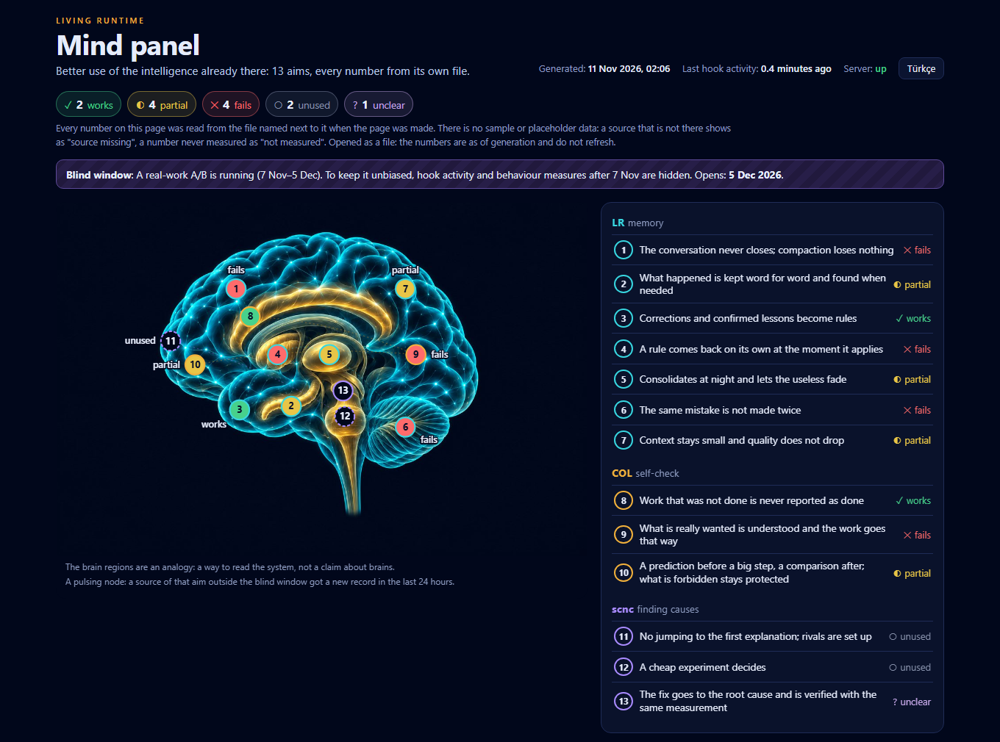

# Zihin paneli

[English](README.md)



Claude Code üstündeki Living Runtime katmanı için tek bir yerel sayfa: LR Memory (hafıza), COL (öz denetim) ve scnc (sebep bulma). [13 amacın](../../docs/AIMS.tr.md) her biri için amacın ne olduğunu, nasıl ölçüldüğünü, son ölçümün ne dediğini ve sayfa oluşturulduğu anda kendi dosyalarınızdan okunan canlı sayıları gösterir.

**Sayfadaki hiçbir şey örnek veri değildir.** Her sayı hangi dosyadan geldiğini ve nasıl hesaplandığını yanında taşır. Kaynağı olmayan "kaynak yok" görünür. Hiç ölçülmemiş olan "ölçülmedi" görünür. Bir amacın durumu ancak siz bir ölçümden sonra karneye yazdığınızda vardır.

## Kurulum ve çalıştırma

```
/plugin marketplace add cihanatak/lr-memory
/plugin install mind@living-runtime
```

Sonra Claude Code içinde:

```
/mind:panel
```

Kabuktan, eklentinin kurulduğu klasörle (klonlanmış depoda `plugins/mind`):

```bash
sh <eklenti klasörü>/scripts/run.sh --open --lang tr
```

`~/.claude/mind/panel.html` dosyasını yazar ve açar. İlk çalıştırma bütün kayıtları okur, dakikalar sürebilir; sonrakiler yalnız değişeni okur.

| Seçenek | Anlamı |
| --- | --- |
| `--open` | Sayfayı tarayıcıda açar. |
| `--out DOSYA` | Sayfanın yazılacağı yer. |
| `--lang en\|tr` | Sayfanın dili; sayfanın içinden de değişir. |
| `--serve PORT` | Sayfayı `127.0.0.1:PORT` adresinde sunar; sayılar dakikada bir yenilenir. |
| `--scorecard DOSYA` | Amaçların üstüne konacak karne. |
| `--config DOSYA` | `~/.claude/mind/config.json` yerine başka bir ayar dosyası. |
| `--no-transcripts` | Kayıt taramasını atlar. |
| `--json` | Sayfayı yazmak yerine toplanan veriyi basar. |

**Gerekenler:** `PATH` üzerinde `python3`, `python` ya da `py` adıyla Python 3.9 ya da daha yenisi ve `sh`. Öbür iki eklenti olmadan da çalışır; onların kaynakları o zaman "kaynak yok" görünür.

## Ne okur

- **COL günlükleri** (`~/.claude/col/*.jsonl` ya da `COL_DATA`) ve **LR Memory klasörü** (`~/.claude/lr-memory` ya da `LR_MEMORY_DATA`): günlük satır sayıları ve alanların izin verdiği sayılar: denetlenen turlar, yakalanan iddialar, tutan ve tutmayan öngörüler, durdurulan anahtarlar, kural hatırlatmaları.
- **İz kayıtları ve gece geçişinin klasörü:** yalnız dosya adları ve sayıları. Rapor metni okunmaz.
- **Bellek kuralları** (`~/.claude/projects/*/memory/*.md`): kaç tane, hangi türden, kaçı ipucu taşıyor, günde kaç tane eklendi.
- **Kayıtlar** (`~/.claude/projects` ya da `LR_MEMORY_TRANSCRIPTS`): oturumlar, özetlemeler, çağrı başına bağlam, kabuk hataları ve tekrarlanan hatalar, hipotez satırları, beceri çağrıları. Yalnız sayılar ve zamanlar saklanır: `~/.claude/mind/cache.json`.

Sayfadaki yollar ev klasöründen başlayarak yazılır (`~/…`); ekran görüntüsü kullanıcı adınızı taşımaz.

## Karne

Yeni bir makinede her amaç ölçülmedi görünür. Sayfa durum tahmin etmez; bir şey ölçtükten sonra durumu siz yazarsınız: `~/.claude/mind/scorecard.json` (ya da `--scorecard DOSYA`):

```json
{
  "as_of": "2026-11-11",
  "source": "kendi kaydım, Ekim",
  "aims": [
    {"id": 8, "status": "works",
     "yardstick": "Tutmayan iddialar: yakalanan ve bana ulaşan",
     "measured": "1.370 turda 15 yakalandı",
     "measured_on": "2026-11-11"}
  ]
}
```

`status` şunlardan biridir: `works` (çalışıyor), `partial` (kısmen), `fails` (tutmuyor), `unused` (kullanılmıyor), `unclear` (belirsiz), `unmeasured` (ölçülmedi). Metin alanları tek bir dize ya da `{"en": …, "tr": …}` olabilir. Yazarın karnesi: [docs/scorecard.json](../../docs/scorecard.json).

## Ayarlar

`~/.claude/mind/config.json` (ya da `--config DOSYA`); bütün anahtarlar isteğe bağlıdır. Örnek ve anahtarların tam listesi [İngilizce README](README.md#configuration) içinde. Önemli olanlar:

- **`outside`**, `{"folders": […], "sessions": […]}` biçiminde bir JSON dosyasını gösterir: hiçbir okuyucunun açmayacağı proje klasörleri ve oturum kimlikleri. Bu kayıtlar açılmadan, adından atlanır.
- **`exclude_logs`**, hiç okunmayacak günlükleri listeler (`.jsonl` uzantısı olmadan).
- **`health_url`** yalnız localhost adresiyse, iki saniyelik tek bir istekle sorulur.
- **`blind`**, kendi üstünüzde, sonucuna bakmadan deney yürütmek içindir. Şimdiki an `from` ile `until` arasındayken, tarihi `from` ya da sonrası olan her satır sayılmadan atılır; sayfa bunu etkilenen her sayının yanında söyler. Kalanlar: sonuç taşımayan sayımlar (günlük oturum, özetleme ve iz dosyası sayıları, kural dosyaları, gece geçişleri) ve tek bir kalp atışı, yani en yeni satırın zamanı. `blind.heartbeat_extra`, yalnız bu kalp atışı için okunacak ek günlük dosyalarını listeler.

## Ne yapmaz

Ağ isteği yapmaz, model çağırmaz, kendi klasörü (`~/.claude/mind` ya da `MIND_DATA`) dışına yazmaz. Okumadığı hiçbir sayıyı göstermez. Beyin resmi sistemi okumak için bir benzetmedir; beyin hakkında bir iddia değildir.

Yalnız standart kütüphane, Python 3.9 ya da daha yenisi. Testler [tests/test_mind.py](../../tests/test_mind.py) dosyasında: geçici bir klasöre küçük bir düzen yazar; sayfadaki sayıların yazılanla birebir aynı olduğunu, kör pencerenin iz bırakmadığını ve sayfanın ağdan hiçbir şey yüklemediğini denetler.
